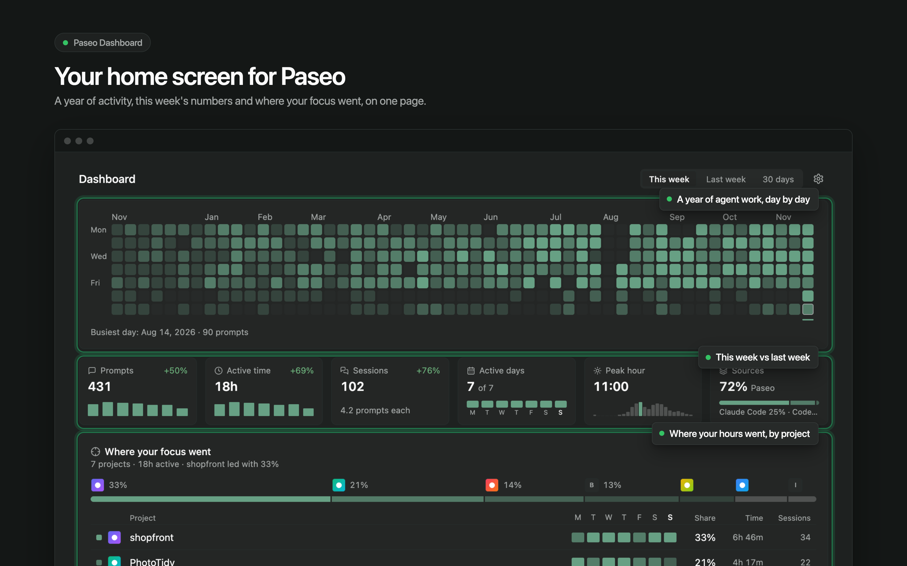
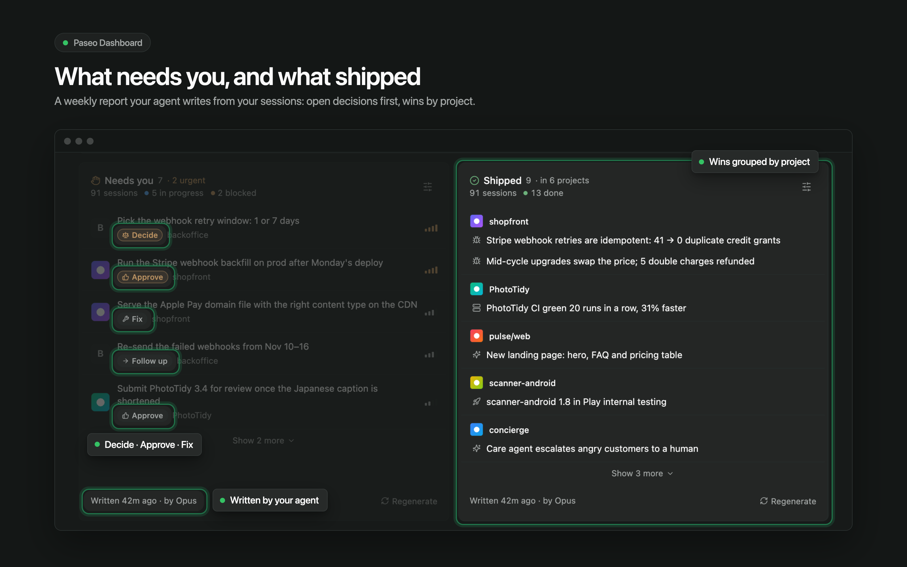
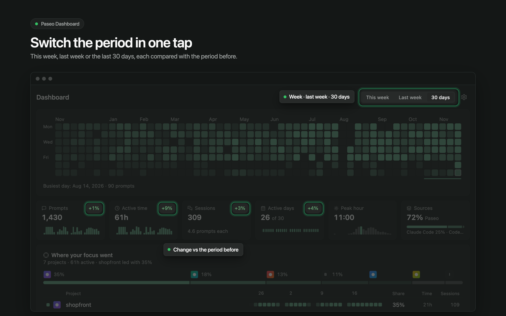
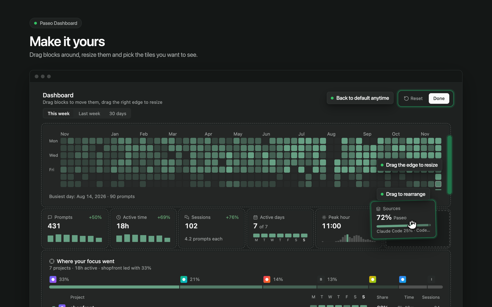
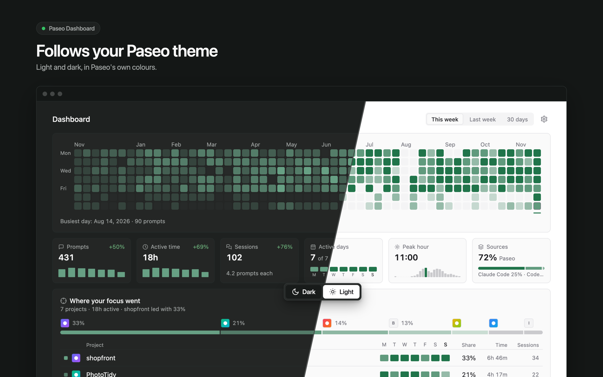

<p align="center">
  
</p>

<h1 align="center">Paseo Dashboard</h1>

<p align="center">
  A home screen plugin for <a href="https://paseo.sh">Paseo</a>: how you work with coding agents, across every agent CLI on the machine.
</p>

<p align="center">
  
</p>

## Install

Requires Paseo 0.16.2 or newer, with **Enable plugins** turned on under **Settings → Plugins**.

From the terminal:

```sh
paseo plugin add git:aspasskiy/paseo-dashboard
```

Or in the app: open **Settings → Plugins**, paste `git:aspasskiy/paseo-dashboard` into **Plugin source** and select **Install plugin**.

Then open it from **Dashboard** at the top of the sidebar or with "Open Dashboard" in the command center.

To update later: `paseo plugin update dashboard`.

## What's on it

- **Activity**: a year of prompts as a heatmap, with your total and your streak.
- **Stat tiles** for this week, last week or the last 30 days: prompts, active time, sessions, active days, peak hour, sources, projects, busiest day, Paseo agents and tool calls.
- **Where your focus went**: every project of the period, its share and its days.
- **Needs you** and **Shipped**: what is waiting on you and what you finished, written by agents when you ask for a report.

Blocks sit on a 12-column grid you can rearrange, resize, add and remove.

## Screenshots

<table>
  <tr>
    <td width="50%"><br><sub>Agent-written report: what needs you and what shipped</sub></td>
    <td width="50%"><br><sub>Where your focus went, last 30 days</sub></td>
  </tr>
  <tr>
    <td width="50%"><br><sub>Rearrange and resize blocks</sub></td>
    <td width="50%"><br><sub>Light theme</sub></td>
  </tr>
</table>

## Data and privacy

Everything is read on the daemon host. Activity comes from the session stores of Paseo, Claude Code, Codex, Gemini CLI, opencode, Copilot CLI and pi, where present: timestamps, project paths and counts, never prompt text. That part sends nothing anywhere.

The **report** is the exception. When you generate one, Paseo helper agents read your session transcripts for the period and summarise them, with the provider and model you choose in the report settings. The text goes to that provider like any other agent prompt and uses your agent quota.

Plugin state (layout, report and its cache) lives in `~/.paseo/plugin-data/dashboard/`.

## Development

```sh
npm install
npm run typecheck
```

To try a local checkout: `paseo plugin install /absolute/path/to/paseo-dashboard`.

Layout:

- `index.client.tsx`, `client/`: the screen and widgets (React Native).
- `index.server.ts`, `server/`: RPC handlers on the daemon; `server/sources/` reads each CLI's session store, `server/report/` builds the report.
- `shared/`: RPC contracts (zod) used by both sides.

## License

[MIT](LICENSE)
